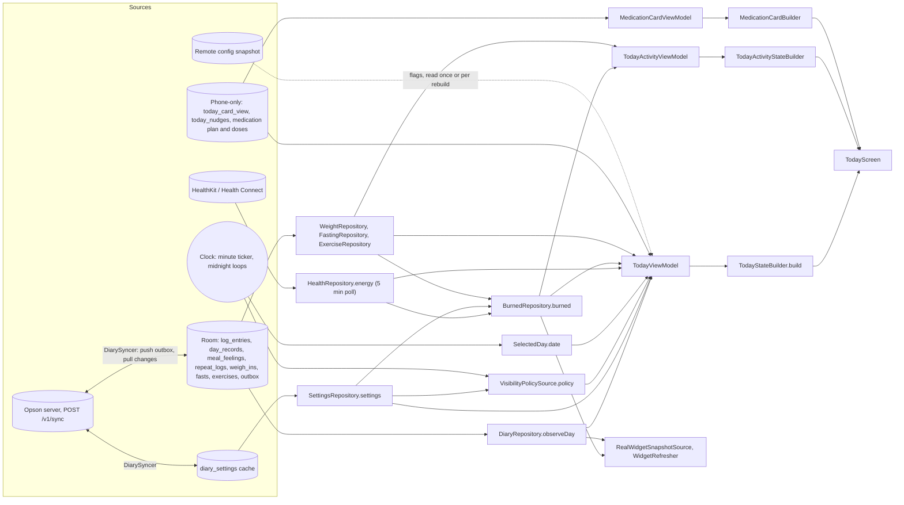

# Today's data: where it comes from and what refreshes it

Written 2026-10-29 from the code on `main` (`adc7c8ec`). Links are relative to this file, so they resolve from the repo root.

## Summary

Today never calls the network. Everything on it is read on the device: the diary's Room tables (foods, water, day records, meal notes, weigh-ins, fasts, exercise), the persisted Settings cache, a few caches that live only on this phone, the remote-config snapshot for release flags, and the platform health store (HealthKit or Health Connect) for energy. Three view models (Today, the Activity card, and Medication's contributed card) combine those as Flows and rebuild their state through pure builders on every emission, so a local write is on screen at once. The server reaches Today only through `DiarySyncer`, which pulls into Room on sign-in, cold boot, warm foreground and reconnect; Room's flows then carry the change to the screen. Health is the one input that is not reactive. It is polled every five minutes while something collects it, with no re-read on foreground, no observer query and no background delivery. Nothing runs in the background on either platform, and there is no pull-to-refresh anywhere in the app. The cheapest real fix is to re-read health on foreground and share one health stream between its four readers.

## The picture

The wiring lives in [TodayViewModel.kt](../../features/today/impl/src/commonMain/kotlin/com/opson/features/today/impl/TodayViewModel.kt) (`inputs()`), [TodayActivity.kt](../../features/today/impl/src/commonMain/kotlin/com/opson/features/today/impl/activity/TodayActivity.kt) and [MedicationCardViewModel.kt](../../features/medication/impl/src/commonMain/kotlin/com/opson/features/medication/impl/today/MedicationCardViewModel.kt). [TodayFeatureEntryPoint.kt](../../features/today/impl/src/commonMain/kotlin/com/opson/features/today/impl/TodayFeatureEntryPoint.kt) places the Activity card and every [TodayCardContribution](../../features/today/src/commonMain/kotlin/com/opson/features/today/TodayCardContribution.kt) (today that is only Medication's) around the main list.

## Every input to Today's state

"Flow" means the screen updates by itself when the source changes. "Edges" means the sync edges: sign-in or cold-boot resolve, warm foreground, reconnect.

| Input | Stored in | Read through | Kind | What refreshes it | Staleness risk |
|---|---|---|---|---|---|
| The day's foods, water, "ate, no details", untracked, closed, meal notes | Room `log_entries`, `day_records`, `meal_feelings`, `repeat_logs` | [`DiaryRepository.observeDay(date)`](../../libraries/diary/impl/src/commonMain/kotlin/com/opson/libraries/diary/impl/DiaryRepositoryImpl.kt) | Flow | Any local write; a sync pull merging rows; the repeat materializer | Low. Another phone's changes wait for the next edge. |
| The day before | Same tables | `observeDay(date - 1)` | Flow | Same | None. `TodayInputs.dayBefore` is collected but [TodayStateBuilder.kt](../../features/today/impl/src/commonMain/kotlin/com/opson/features/today/impl/TodayStateBuilder.kt) never reads it. |
| Logging habits (usual meal times, the late-day card's evening) | Room, the last 28 days | `observeDays(today - 28, today)`, re-keyed when the ticker's date changes | Flow | Writes, a change to meal times, the date turning | Low |
| Settings: targets, mode, water goal, card switches, meal groups, exercise options | `diary_settings` persistent cache, synced through the outbox | [`SettingsStore.settings`](../../libraries/diary/impl/src/commonMain/kotlin/com/opson/libraries/diary/impl/SettingsStore.kt) | Flow | Local edit; a pull | On a new phone they are defaults until the first pull lands, so the policy is No numbers until then (by design). |
| Visibility policy | Derived from settings, `isKnown` and a boundary tick | [`SettingsVisibilityPolicySource.policy`](../../libraries/diary/impl/src/commonMain/kotlin/com/opson/libraries/diary/impl/SettingsVisibilityPolicySource.kt) | Flow | Settings; the reveal time and midnight, waited in steps of at most a minute | Low |
| Which day is shown | Memory | [`SelectedDay.date`](../../libraries/diary/impl/src/commonMain/kotlin/com/opson/libraries/diary/impl/SelectedDayImpl.kt) | Flow | Taps; a midnight loop in steps of at most a minute, which only rolls if you were on today | Up to a minute of yesterday-as-today after midnight or on the first open of the morning. No foreground or time-change hook. |
| Time of day, to five minutes | Clock | [`MinuteTicker`](../../libraries/diary/src/commonMain/kotlin/com/opson/libraries/diary/Fasts.kt), stepped to 5 minutes in `now()` | Flow | Each wall-clock minute | None |
| "Expended so far" | HealthKit or Health Connect | [`HealthRepository.energy(today)`](../../libraries/health/impl/src/commonMain/kotlin/com/opson/libraries/health/impl/RealHealthRepository.kt) | Polled Flow | First collection, then every 5 minutes; connect and disconnect through `status` | Up to 5 minutes of awake time after Health has the data. Today's date only. |
| Burned (the hero card's goal under a deficit or surplus, the Activity card) | Settings, latest weigh-in, Health's resting energy, Health's activity, logged exercise, digesting food | [`BurnedRepository.burned(date)`](../../libraries/health/impl/src/commonMain/kotlin/com/opson/libraries/health/impl/RealBurnedRepository.kt) | Flow, the health part polled | Writes and settings at once; activity every 5 minutes; resting from Health once per collection | Same 5 minutes. Resting is the last whole day in Health, so it is a day old by definition. |
| Weigh-ins for the Weight row | Room `weigh_ins` | [`WeightRepository.observeWeighIns(since)`](../../libraries/diary/impl/src/commonMain/kotlin/com/opson/libraries/diary/impl/RecordRepositories.kt) | Flow | Writes; a pull | Low. `since` is fixed when the view model is made. |
| Fasting card | Room `fasts`, settings, ticker | [`FastingRepository.observeLatest()`](../../libraries/diary/impl/src/commonMain/kotlin/com/opson/libraries/diary/impl/FastingRepositoryImpl.kt) plus [TodayFastingCard.kt](../../features/today/impl/src/commonMain/kotlin/com/opson/features/today/impl/TodayFastingCard.kt) | Flow, ticks each minute while it can show | Writes; a pull; each minute | Low |
| Logged exercise (Activity card) | Room `exercises` | [`ExerciseRepository.observeDay`](../../libraries/diary/impl/src/commonMain/kotlin/com/opson/libraries/diary/impl/ExerciseRepositoryImpl.kt) | Flow | Writes; a pull | Low |
| Water | Part of the day record and settings | `observeDay`, written by `setWater` from [WaterTaps.kt](../../features/today/impl/src/commonMain/kotlin/com/opson/features/today/impl/WaterTaps.kt) | Flow | Writes; a pull | Low |
| Summary card page and collapse | `today_card_view` cache, this phone only | [`TodayCardViewStore.view`](../../features/today/impl/src/commonMain/kotlin/com/opson/features/today/impl/TodayCardView.kt) | Flow | Local only | None. Never syncs, on purpose. |
| Late-day card put away | `today_nudges` cache, this phone only | [`TodayNudgeStore`](../../features/today/impl/src/commonMain/kotlin/com/opson/features/today/impl/TodayNudgeStore.kt), rules in [LowLoggingNudge.kt](../../features/today/impl/src/commonMain/kotlin/com/opson/features/today/impl/LowLoggingNudge.kt) | Flow | Local only | None |
| Undo after a log | Memory | `RecentLogEvents.latest` | Flow | The logger writing | None |
| Medication card | Plan in a device cache, doses in Room, never synced | [`MedicationRepositoryImpl`](../../libraries/medication/impl/src/commonMain/kotlin/com/opson/libraries/medication/impl/MedicationRepositoryImpl.kt) `plan`, `observeDoses()` | Flow | Local writes; the shown day changing | A second phone never sees the doses. `release.medication` is read once per day shown. |
| Release flags (`release.health`, `goalsAndEnergy`, `todaySummary`, `todaySelect`, `foodActions`, `exercise`, `fasting`) | Remote-config snapshot on disk | `FlagConfigValue`, see [TodayReleaseFlags.kt](../../features/today/impl/src/commonMain/kotlin/com/opson/features/today/impl/TodayReleaseFlags.kt) | One-shot reads | Read when inputs rebuild. `health`, `goalsAndEnergy`, `todaySummary` (for weigh-ins and card view) and `exercise` are read once, when the view model is created | A remote flip lands on the next rebuild at best, and for those four only after the process restarts. |
| Health connected or not | `AppData.healthConnected` in [AppCache.kt](../../libraries/opson/src/commonMain/kotlin/com/opson/libraries/AppCache.kt) plus the store's availability | `HealthRepository.status` | Flow | Re-checked at the start of each `energy()` collection and when More or Integrations resumes | Access revoked in Health Connect's own screen goes unnoticed until then; reads just fail to null. |

The energy range itself is computed in [ExerciseRange.kt](../../features/today/impl/src/commonMain/kotlin/com/opson/features/today/impl/ExerciseRange.kt) (`todayRange`) from settings, the day, Expended and Burned, using `Targets.rangeFor` and `burnedFor` in [Targets.kt](../../libraries/nutrition/src/commonMain/kotlin/com/opson/libraries/nutrition/Targets.kt) and [Exercise.kt](../../libraries/nutrition/src/commonMain/kotlin/com/opson/libraries/nutrition/Exercise.kt). Pure functions, so they are only as fresh as their inputs.

One thing about first paint: `TodayState` starts with `loading = true`, and `combine` waits for every input's first value. With a health store connected, that includes the first HealthKit or Health Connect read (Expended and Burned). So Today's first frame waits on the health store. It is normally quick, but a query whose callback never comes back would hold the spinner.

## Sync and refresh triggers

All server reconciliation hangs off [UserScopedSyncCoordinator.kt](../../libraries/opson/impl/src/commonMain/kotlin/com/opson/libraries/opson/impl/UserScopedSyncCoordinator.kt), fed by [SyncTriggers.kt](../../libraries/opson/impl/src/commonMain/kotlin/com/opson/libraries/opson/impl/SyncTriggers.kt) and run through `runWhen` in [RunWhen.kt](../../libraries/flowroutines/src/commonMain/kotlin/com/opson/libraries/flowroutines/RunWhen.kt). Two syncers are registered: `DiarySyncer` (everything Today shows from the server) and `SubmittedFoodsStore` (food search, not Today).

### Cold start

| What starts | What it does for Today |
|---|---|
| Diary sync | The coordinator keys on the active account, a level that replays, so the first sync fires as soon as auth resolves and cannot miss the edge. [DiarySyncer.kt](../../libraries/diary/impl/src/commonMain/kotlin/com/opson/libraries/diary/impl/DiarySyncer.kt) pushes the outbox and pulls. On a new phone the first pull can take several requests; it asks for the next sync itself, and once settings land the policy leaves No numbers. |
| Repeats | `RepeatScheduler` in [RepeatRepositoryImpl.kt](../../libraries/diary/impl/src/commonMain/kotlin/com/opson/libraries/diary/impl/RepeatRepositoryImpl.kt) logs today's due repeats once the user is signed in and their settings are known. |
| Config | [OfflineFirstAppConfigRepository.kt](../../libraries/config/impl/src/commonMain/kotlin/com/opson/libraries/config/impl/repository/OfflineFirstAppConfigRepository.kt) fetches on the cold-boot foreground. The first frame uses the cached snapshot, or the bundled fallback on a fresh install. |
| Clock loops | The `SelectedDay` midnight loop, the policy's reveal-and-midnight loop and the widget's midnight loop. |
| Widget | [WidgetRefresher.kt](../../libraries/widgets/impl/src/commonMain/kotlin/com/opson/libraries/widgets/impl/WidgetRefresher.kt) collects [RealWidgetSnapshotSource.kt](../../libraries/widgets/impl/src/commonMain/kotlin/com/opson/libraries/widgets/impl/RealWidgetSnapshotSource.kt) in the app scope. That includes a Burned flow, so it runs a health poll of its own. |

### Warm foreground

Foreground is `UIApplicationDidBecomeActiveNotification` on iOS ([IosAppLifecycle.kt](../../libraries/opson/src/iosMain/kotlin/com/opson/libraries/opson/IosAppLifecycle.kt)) and process `onStart` on Android ([AndroidAppLifecycle.kt](../../libraries/opson/src/androidMain/kotlin/com/opson/libraries/opson/AndroidAppLifecycle.kt)). On iOS that notification also fires after Control Center, a Face ID prompt or a system alert closes, so "foreground" happens more often there than it sounds.

| Runs on warm foreground | What Today sees |
|---|---|
| Diary sync (not throttled) | Pulled rows arrive through Room's flows |
| Config refresh, at most every 5 minutes (0 in the dev database) | New flag values sit in the map until Today next rebuilds; four are never re-read |
| Repeats `logDue()` | Any newly due repeat appears |
| Widget re-reads the date | Widget only |
| Auth re-resolve, session healer, profile edit flush | Nothing directly |
| Nothing for health, `SelectedDay` or medication | The health poll keeps its own clock |

### Background

Nothing is scheduled. The iOS app declares no `UIBackgroundModes`, uses no `BGTaskScheduler`, has no HealthKit background-delivery entitlement ([iosApp.entitlements](../../apps/ios/iosApp/iosApp.entitlements), [Info.plist](../../apps/ios/iosApp/Info.plist)) and runs no `HKObserverQuery`. Android has no WorkManager; `AlarmManager` is used only for meal reminders, and the time-change receiver in [ReminderReceivers.kt](../../libraries/reminders/impl/src/androidMain/kotlin/com/opson/libraries/reminders/impl/ReminderReceivers.kt) replans reminders, nothing else. Telemetry flushes on background.

While the process is still alive in the background, the flows keep running: Today collects in `viewModelScope`, not a lifecycle-bound scope, and the widget collects in the app scope. On iOS the app is suspended within seconds and nothing fires. On Android the 5-minute health poll can fire from the background. Health Connect refuses reads from an app that is not in the foreground unless it holds the background-read permission, which [the manifest](../../libraries/health/impl/src/androidMain/AndroidManifest.xml) does not declare. `guarded()` turns that refusal into `null`, Burned then falls back to everyday activity, and the widget can publish a snapshot built on the fallback. This is a reading of the code; it needs a device check.

### Reconnect

`cameOnline` comes from `AppState.isOffline` ([AppStateImpl.kt](../../libraries/networking/impl/src/commonMain/kotlin/com/opson/libraries/networking/impl/AppStateImpl.kt)), which is offline when the OS reports no route or when Opson's own requests stop completing. The initial value is dropped and flaps are debounced for 750 ms. The edge re-runs the diary sync. [ConnectivityEdgeDispatcher.kt](../../libraries/opson/impl/src/commonMain/kotlin/com/opson/libraries/opson/impl/ConnectivityEdgeDispatcher.kt) also dispatches `ConnectivityRegained` for auth healing and the profile flush. Health is local and unaffected.

### Day roll

| Piece | How it notices midnight |
|---|---|
| `SelectedDay` | Loop in steps of at most a minute; rolls only if you were looking at today |
| Visibility policy | Ticks at the reveal time and at midnight, same stepping |
| Habits, late-day card | The ticker's date changes and the 28-day window re-keys |
| Health | `energy(day)` is keyed on the shown day, so it re-subscribes when the day rolls |
| Medication card | `LaunchedEffect(day)` re-keys it |
| Repeats | One long `delay` to midnight, plus every foreground |
| Widget | One long `delay` to midnight, plus every foreground |

A coroutine `delay` does not count time the phone was asleep. The policy and `SelectedDay` loops step by a minute for that reason; the repeats and widget loops lean on the foreground edge instead. Nothing listens for `UIApplicationSignificantTimeChangeNotification` or Android's `TIME_SET`, `TIMEZONE_CHANGED` and `DATE_CHANGED` on Today's behalf, so a manual clock or zone change is picked up by the next minute step.

### Retry, backoff and the outbox

Syncs started by an edge retry with `RunWhenRetry.exponential()`: the first attempt, then 5, 10, 20, 40 and 80 seconds (capped at 2 minutes, 5 retries). After that the loop waits for the next edge. Offline, a sync is parked as a success and the reconnect edge re-runs it, so a dead spot does not burn the ladder.

Writes go through `DiaryWriter` in [DiaryStore.kt](../../libraries/diary/impl/src/commonMain/kotlin/com/opson/libraries/diary/impl/DiaryStore.kt). The row and its outbox mutation commit in one transaction, the screen updates from Room straight away, and `requestSync()` runs one sync 2 seconds after the last write. That sync is tried once. If it fails, the rows wait for the next foreground, reconnect or write.

A drain sends up to 10 requests of 200 rows, follows `hasMore` on the pull side, and stops early if the same page comes back twice. A pulled row loses to a local row with a change still waiting. A refused row is rolled back to its base and emitted as a `SyncRejection`. Rows dated more than 8 days past today (UTC) stay queued until the server will take them. Settings use the same outbox with patch payloads and are not queued at all until the user's settings are known.

Some of what Today shows never syncs: medication, repeat rules (the entries they log do), the card view and the nudges.

The pattern itself is written up in [outbox.md](outbox.md).

## Health data

Health is read only while a flow collects it. With Today on today and the flags on, there are four collectors, each with its own 5-minute loop:

1. `TodayViewModel.expended()`, for "Expended so far" and the range's exercise adjustment.
2. `TodayViewModel.burned()`, through `BurnedRepository.burned`.
3. `TodayActivityViewModel`, through `BurnedRepository.burned` again.
4. The widget's `RealWidgetSnapshotSource.burned()`, in the app scope, whether or not Today is open.

Each read in [HealthKitReader.kt](../../libraries/health/impl/src/iosMain/kotlin/com/opson/libraries/health/impl/HealthKitReader.kt) is three queries: an active-energy sum, a resting-energy sum and a workout sample query. [HealthConnectReader.kt](../../libraries/health/impl/src/androidMain/kotlin/com/opson/libraries/health/impl/HealthConnectReader.kt) does one aggregate, a session read, and one more aggregate per workout session. Each `burned()` collection also reads the last week once to find Health's most recent whole-day resting energy. The HealthKit reader is Kotlin over `platform.HealthKit`; there is no Swift half.

Nothing is cached, deliberately. The KDoc on `RealHealthRepository` says values are held nowhere; only the "connected" choice is stored.

Each loop reads every 5 minutes (`REFRESH_EVERY`), measured with a coroutine `delay`, so sleep does not count. After you come back to the app, the next read happens when the remainder of that delay has passed in awake time. The four loops are not in phase, so the hero card's Expended and the Activity card can disagree for up to 5 minutes.

There are no observer queries, no background delivery and no change tokens on either platform.

### "I just finished a workout, why isn't it on Today?"

Three waits stack up:

1. The watch has to sync the workout to the phone's Health store. That is Apple's (or the watch maker's) schedule, often a minute or two, longer if the phone is locked.
2. Opson reads only when its loop next fires. Opening the app does not trigger a read, so this adds up to 5 minutes of the app being open.
3. The Activity card and Expended refresh on separate loops and may show the new workout at different moments.

Two accidental ways to force a read today: leave and come back to today in the day header (the health flow is keyed on the shown day, so it re-subscribes and reads at once), or kill and relaunch. Exercise logged by hand in Opson is a Room write and shows immediately.

## Pull to refresh

There is none. A search for `PullToRefresh`, `pullRefresh`, `refreshable` and `UIRefreshControl` across Kotlin and Swift finds nothing, and Today's list in [TodayScreen.kt](../../features/today/impl/src/commonMain/kotlin/com/opson/features/today/impl/TodayScreen.kt) is a plain `LazyColumn`. `DiarySync.syncNow()` exists, but only sign-out and the data export in Settings call it.

## Gaps and what to do, in order

| # | Change | What people notice | Cost | Risk |
|---|---|---|---|---|
| 1 | Re-read health on foreground, and share one stream. In `RealHealthRepository`, merge the foreground edge (and a manual trigger for 2) into the read loop, and share `energy(day)` per day with `shareIn(WhileSubscribed)` so four loops become one. | A workout already in Health shows within a second of opening Opson, not up to 5 minutes later. Expended, Burned, the Activity card and the widget agree. | Small | Low. iOS "foregrounds" often (Control Center, Face ID), so keep a 30-second floor between reads. |
| 2 | Pull to refresh on Today: run `DiarySync.syncNow()` and the health re-read together, holding the spinner until both finish or about 10 seconds pass. Compose Material 3's `PullToRefreshBox` works on both platforms. | A familiar way to ask "is this current?", and it covers another phone's logs as well as health. | Small to medium: one action, a `refreshing` flag, a `refreshNow()` on `HealthRepository` | It cannot pull from the watch. If the watch has not synced to Health, nothing changes, so the empty result needs a quiet line rather than silence. Check it does not fight the list's drag, long-press and swipe gestures (`release.todaySelect`). |
| 3 | Observe HealthKit while the app is open: an `HKObserverQuery` on workouts and active energy, started on foreground and stopped on background, feeding the trigger from 1. On Android, check a Health Connect changes token on foreground. | Today updates the moment Health receives a workout, with no pull. | Medium | Low while foreground-only. Background delivery (`enableBackgroundDelivery` and the `healthkit.background-delivery` entitlement) is a bigger step whose only payoff is the widget, at a battery and review cost. Leave it until the widget leans on Burned. |
| 4 | Roll the day on foreground and on clock changes: `SelectedDayImpl` re-checks on the foreground edge and on `UIApplicationSignificantTimeChangeNotification`, `TIME_SET` and `TIMEZONE_CHANGED`. | No minute of yesterday labelled Today on the first open of the morning; a zone change lands at once. | Tiny | Low. Keep the rule that it only rolls if the person was on today. |
| 5 | A "last updated" hint. `sync_state.lastSuccessAtEpochMs` is written on every sync and never read. Show "Synced 3 min ago" in the ⋮ menu or under the pull indicator, and "Read from Apple Health at 2:41 pm" on the Activity card. | People can tell a stale screen from a quiet day. | Small | Clutter on a calm screen. A time is not a number the modes hide, but keep it off the hero card. |
| 6 | Stop health reads in the background on Android: pause the read loop on `OnBackground`, or collect Today's inputs with `WhileSubscribed` so they stop with the screen. | No Burned silently falling back to everyday activity while backgrounded, and no widget built on that. Less battery. | Small | Low. Confirm the failure on a device first; if Health Connect allows the read in that window, this is only a battery fix. |
| 7 | Retry the sync after a write, with the coordinator's backoff or one delayed retry. | A food logged during a server hiccup reaches other phones in seconds, not at the next foreground. | Small | Low. The sync is idempotent and single-flight. |
| 8 | Read release flags reactively: drive the inputs behind `release.health`, `goalsAndEnergy`, `todaySummary` and `exercise` from `configStream()` instead of a check at construction. | A kill switch works mid-session rather than after a relaunch. | Medium | The screen can re-lay out under someone's thumb. Mostly worth it for kill switches. |

Two small cleanups sit outside the table. `TodayInputs.dayBefore` costs a Room observation that nothing reads. And Today's first frame waits for the first health read; a timeout on the health flows (or a null first value) would unblock it, at the price of the range moving once the reading lands.
